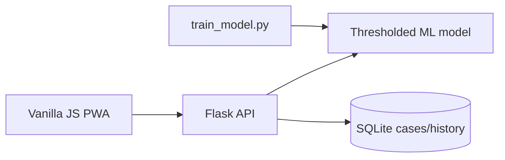

# FraudGenie

FraudGenie is an installable fraud-detection dashboard for scoring card transactions, investigating alerts, and explaining model decisions.

## Screenshots

Run the dashboard locally to capture screenshots for your report; it provides Dashboard, Check, Batch, History, Live, Alerts, and Model views.

## Architecture



## Features

- Synthetic fraud scenarios, model comparison and threshold calibration.
- Explainable local baseline-substitution factors for every decision.
- Single checks, CSV batches, real-time simulation, alert case management, filtering/export, sensitivity controls, and Chart.js analytics.
- PWA install support, dark mode, offline fallback, secure headers, optional session authentication, and rate limiting.

## ML pipeline

`train_model.py` generates normal activity and card-testing, takeover, and stolen-card scenarios. It compares scaled Logistic Regression, Random Forest, and HistGradientBoosting with 5-fold stratified cross-validation, selecting the best model by PR-AUC. It then chooses an F1-maximising threshold on a held-out test split. Accuracy alone is misleading when fraud is rare: a model could label everything genuine and still appear accurate, so ROC-AUC, PR-AUC, precision and recall are reported too.

Latest synthetic run: Random Forest selected; accuracy **99.66%**, precision **99.81%**, recall **92.78%**, F1 **96.16%**, ROC-AUC **96.44%**, PR-AUC **93.58%**.

## API

| Endpoint | Purpose |
| --- | --- |
| `POST /api/predict` | Score one transaction with factors and reasons |
| `POST /api/upload` | Score a CSV (maximum 5 MB / 5,000 rows) |
| `POST /api/demo`, `/api/simulate`, `/api/reset` | Demo, live event, and reset |
| `GET /api/stats`, `/api/history`, `/api/alerts` | Analytics, history and cases |
| `PATCH /api/alerts/:id` | Update case status and note |

## Setup and testing (PowerShell)

```powershell
.\venv\Scripts\Activate.ps1
python -m pip install --upgrade pip
pip install --only-binary=:all: -r requirements.txt
python make_icons.py
python train_model.py
pytest -q
python app.py
```

Open http://127.0.0.1:5000. For another Wi-Fi device, run `ipconfig` and browse to `http://YOUR_IPV4:5000` after allowing Python through Windows Firewall.

## Real data

Use `python train_model.py --data path\to\creditcard.csv` for the Kaggle Credit Card Fraud schema (`Time`, `V1`–`V28`, `Amount`, `Class`) or a PaySim CSV (`step`, `amount`, `isFraud`). The loader automatically maps each schema to FraudGenie's nine app features.

## Deployment

Render uses `render.yaml` (build: `pip install -r requirements.txt && python train_model.py`, start: `gunicorn app:app`). Docker: `docker build -t fraudgenie .` then `docker run -p 5000:5000 fraudgenie`. GitHub Actions and GitLab CI retrain and run pytest.

## Project report notes

**Problem:** fraud needs accurate, understandable alerts. **Objectives:** classify transactions, explain risk, and provide analyst workflows. **Method:** synthetic scenario generation, cross-validated supervised learning, calibrated threshold, and local feature substitution. **Results:** strong held-out discrimination and recall on synthetic data. **Limitations:** synthetic patterns do not replace production data; a real deployment requires monitoring and human review. **Future scope:** connect live payment streams, model drift checks, richer authentication and audited role-based access.
